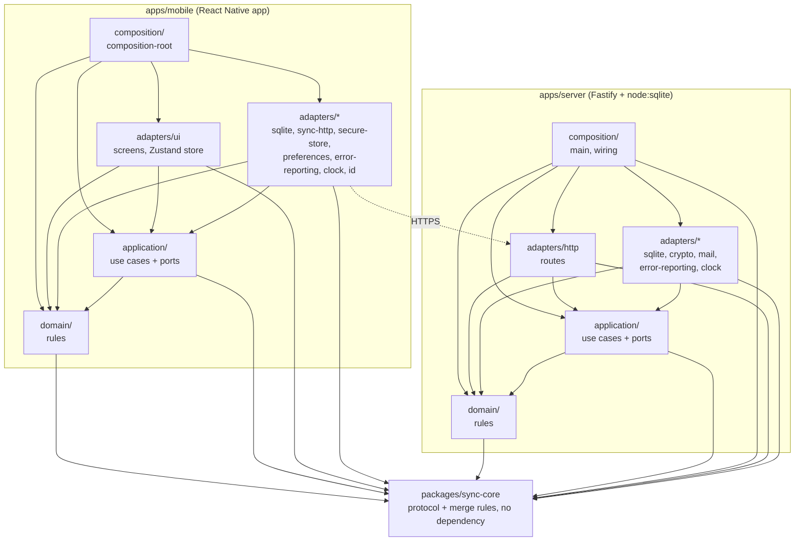

# Architecture

The app and the server follow a hexagonal architecture ([constitution](../.specify/memory/constitution.md),
Principle VI): the rules sit in the middle and know nothing about the outside world; everything that
touches a database, the network, the screen or the clock sits at the edge and plugs into the middle
through small interfaces called ports. The [dependency-cruiser](../.dependency-cruiser.cjs) rules
enforce it: `yarn test:architecture` fails when a layer imports something it must not.

## The layers and the direction of dependencies

An arrow reads "imports". Dependencies point inward: nothing in the middle imports the edge. The composition sits outside everything and imports every layer it wires.

## The parts

- **Domain** (`domain/`): pure rules, with no framework and no I/O. In the app: names,
  quantities, articles, categories, shopping lists and their views. On the server: accounts,
  devices, login attempts, and how a change is applied or merged by name.
- **Application** (`application/`): one file per use case (`add-article-to-list`,
  `synchronize`, `sign-in`, ...), plus the ports those use cases need. It imports the domain, itself and
  `packages/sync-core` only.
- **Ports** (`application/ports/`): interfaces the application defines and the edge implements:
  repositories, unit of work, clock, id generator, error reporter, and the sync, account and admin
  servers on the app side; store, mailer, password hasher and pairing crypto on the server side. A
  port is named for what the application needs, not for the technology behind it.
- **Adapters** (`adapters/`): implement the ports (driven adapters) or drive the application
  (the UI in the app, the HTTP routes on the server). An adapter never imports another adapter.
  The French text of the app exists only in the UI adapter, and so does Zustand.
- **Composition** (`composition/`): the one module that knows every adapter. It builds them at
  startup and hands them to the use cases ([app](../apps/mobile/src/composition/composition-root.ts),
  [server](../apps/server/src/composition/wiring.ts)). Only the entry point imports it (enforced by the dependency rules
  for the app, a convention on the server).
- **`packages/sync-core`**: the sync protocol types and the merge rules, shared by the app and the
  server so that both converge on the same result. It is pure and depends on nothing; it is the
  only workspace package the domain and the application may import.
- **The server** ([`apps/server/`](../apps/server/README.md)): the same four layers. It listens
  on `127.0.0.1` only; Caddy is its public HTTPS entry. See the [sync server](sync-server.md)
  guide to run it.

## Adapters of the app

In [`apps/mobile/src/adapters/`](../apps/mobile/src/adapters/).

| Folder / adapter                                                         | Port it implements                                                                                                            | What it does                                                                                            |
| ------------------------------------------------------------------------ | ----------------------------------------------------------------------------------------------------------------------------- | ------------------------------------------------------------------------------------------------------- |
| `sqlite/` (`SqliteUnitOfWork`, `sqlite*Repository`)                      | `UnitOfWork`, `CategoryRepository`, `ArticleRepository`, `ShoppingListRepository`, `ListItemRepository`, `AppStateRepository` | Stores the lists, articles and categories in SQLite through `expo-sqlite`, one transaction per use case |
| `sqlite/` (`sqliteSyncStateRepository`, `sqliteChangeRecorder`)          | `SyncStateRepository`, `ChangeRecorder`                                                                                       | Keeps the sync cursor and the local changes waiting to be sent                                          |
| `sqlite/` (`sqlitePulledRowsApplier`, `sqliteLocalDataEraser`)           | `PulledRowsApplier`, `LocalDataEraser`                                                                                        | Applies the rows pulled from the server; erases local data on sign-out or account deletion              |
| `sqlite/` (`prepareDatabase`, `migrate`, `openDatabase`)                 | none (start-up code used by the composition)                                                                                  | Opens the database, configures it and runs the migrations                                               |
| `sync-http/` (`createSyncServer`)                                        | `SyncServer`                                                                                                                  | Pushes and pulls changes over HTTPS, with a timeout and typed failures                                  |
| `sync-http/` (`createAccountServer`)                                     | `AccountServer`                                                                                                               | Sign-in, password choice, reset and change, own-account deletion                                        |
| `sync-http/` (`createAdminServer`)                                       | `AdminServer`                                                                                                                 | Invites, lists, suspends, reactivates and deletes accounts; lists and revokes devices                   |
| `secure-store/` (`SecureStoreCredentialStore`)                           | `CredentialStore`                                                                                                             | Keeps the device credential in the OS keychain (`expo-secure-store`), this device only                  |
| `preferences/` (`KvAppearanceStore`)                                     | `AppearanceStore`                                                                                                             | Stores the light, dark or system appearance in the `expo-sqlite` key-value store                        |
| `error-reporting/` (`createSentryErrorReporter`, `ConsoleErrorReporter`) | `ErrorReporter`                                                                                                               | Sends crashes to Sentry with email addresses scrubbed, or prints them when no DSN is set                |
| `clock/` (`SystemClock`)                                                 | `Clock`                                                                                                                       | Gives the current time                                                                                  |
| `id/` (`CryptoIdGenerator`)                                              | `IdGenerator`                                                                                                                 | Generates UUIDs                                                                                         |
| `ui/`                                                                    | none: it drives the use cases (`ScreenTrackingReporter` also wraps `ErrorReporter` to add the current screen)                 | React Native Paper screens, navigation, theme, icons and the Zustand store                              |

## Adapters of the server

In [`apps/server/src/adapters/`](../apps/server/src/adapters/).

| Folder / adapter                                                                | Port it implements                                                                           | What it does                                                                                                   |
| ------------------------------------------------------------------------------- | -------------------------------------------------------------------------------------------- | -------------------------------------------------------------------------------------------------------------- |
| `http/` (`buildApp`, `routes/`)                                                 | none: it drives the use cases                                                                | Fastify routes for accounts, admin, auth, devices, sync and health, with schema validation and authentication  |
| `sqlite/` (`SqliteStore`, `NodeSqlDatabase`)                                    | `ServerStore`, with the account, auth-attempt and ended-credential repositories it hands out | Stores accounts, devices and shopping data in SQLite through `node:sqlite`, and runs the migrations            |
| `crypto/` (`systemRandom`, `createPairingCrypto`)                               | `Random`, `PairingCrypto`                                                                    | Random bytes, and the credentials and temporary passwords handed to a device                                   |
| `crypto/` (`createPasswordHasher`)                                              | `PasswordHasher`                                                                             | Hashes and checks passwords with scrypt                                                                        |
| `crypto/` (`systemIdGenerator`)                                                 | `IdGenerator`                                                                                | Generates UUIDs                                                                                                |
| `mail/` (`createSmtpMailer`, `createConsoleMailer`, `createUnconfiguredMailer`) | `Mailer`                                                                                     | Sends invitation and reset emails over SMTP, prints them in development, or refuses when no mail is configured |
| `error-reporting/` (`createSentryErrorReporter`, `ConsoleErrorReporter`)        | `ErrorReporter`                                                                              | Sends errors to Sentry with personal data scrubbed, or prints them to the console                              |
| `clock/` (`systemClock`)                                                        | `Clock`                                                                                      | Gives the current time                                                                                         |

## Going further

- [Repository layout](repository-layout.md): where each folder of the monorepo sits.
- [Architecture decision records](adr/README.md): why the lasting technical choices were made.
- [Server sync specification](../specs/003-server-sync/spec.md) and
  [multi-user specification](../specs/004-multi-user/spec.md): what the server and the sync protocol
  must do.
