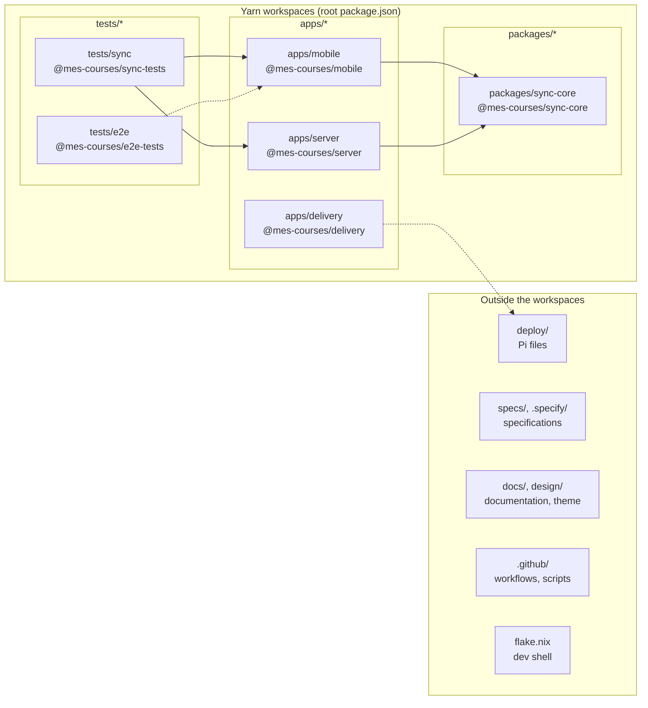

# Repository layout

This is a Yarn workspaces monorepo ([research R20](../specs/001-shopping-lists/research.md)).

The diagram shows the three workspace groups declared in the root `package.json` (`apps/*`, `packages/*`, `tests/*`) and the folders outside them. A solid arrow reads "depends on" (a `@mes-courses/*` dependency in `package.json`). A dotted arrow is a relation with no package dependency: the end-to-end tests drive the built app, and the delivery agent runs on the Pi from the units in `deploy/`.

| Path                      | What it holds                                                                  |
| ------------------------- | ------------------------------------------------------------------------------ |
| `apps/mobile/`            | The Expo app (`@mes-courses/mobile`), with its Jest, Storybook and Metro setup |
| `tests/e2e/`              | The Detox end-to-end journeys (`@mes-courses/e2e-tests`), test-only            |
| `apps/server/`            | The sync server (`@mes-courses/server`)                                        |
| `packages/sync-core/`     | The protocol types and merge rules shared by the app and the server            |
| `tests/sync/`             | The tests that run the app and the server together (`@mes-courses/sync-tests`) |
| `apps/delivery/`          | The Pi's delivery agent (`@mes-courses/delivery`) and the CI manifest command  |
| `deploy/`                 | The Pi files: systemd units and timer, Caddyfile, environment templates, keys  |
| `specs/`, `.specify/`     | Feature specifications and the Spec Kit configuration                          |
| `docs/adr/`               | The [architecture decision records](adr/README.md)                             |
| `design/`                 | The [Material 3 theme, mockups and icon script](../design/README.md)           |
| `flake.nix`, `flake.lock` | The Nix dev shell                                                              |
| `.github/`                | The workflows (`ci`, `e2e`, `deliver-staging`, `release`) and their scripts    |
